# ⚡ Pageneitor

**Tu navegador, limpio. Tus enlaces, bajo control. Tu asistente, siempre disponible.**

Pageneitor es una aplicación de escritorio para Windows que guarda, organiza y encuentra tus enlaces sin llenar el navegador de pestañas. Combina un banco visual con miniaturas, credenciales, subenlaces, agrupación por dominio, un asistente con IA local y un panel de estadísticas completo.

[](https://github.com/genioloko19/PageNeitor/releases)
[](LICENSE)
[](https://www.python.org/)
[](https://www.microsoft.com/windows)
[](#-privacidad)

<p align="center">
  <a href="https://github.com/genioloko19/PageNeitor/releases/latest">
    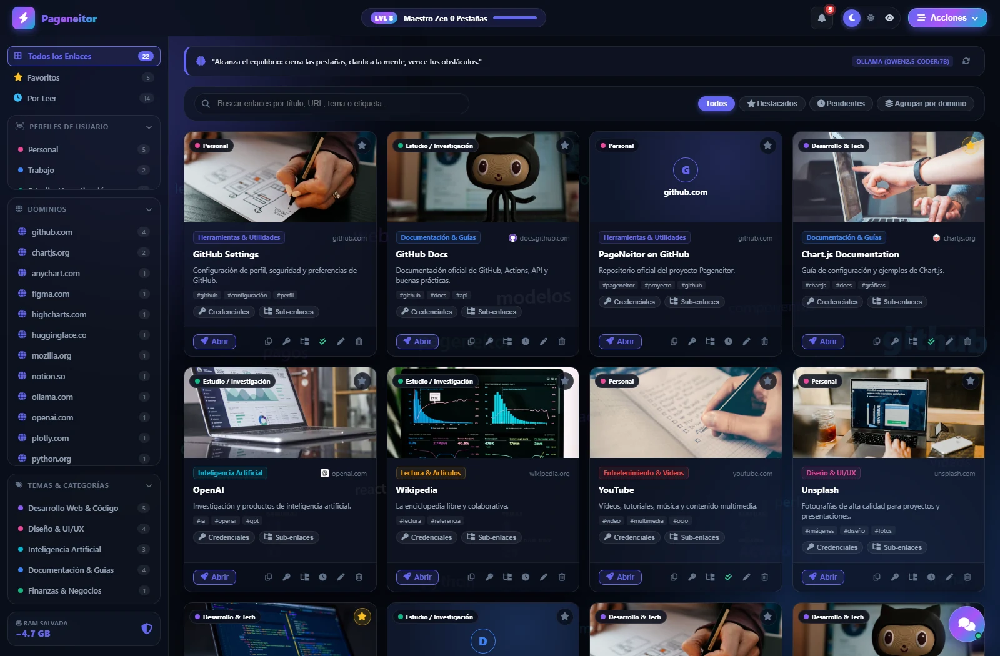
  </a>
</p>

<p align="center">
  <a href="https://github.com/genioloko19/PageNeitor/releases/latest"><strong>⬇️ Descargar Pageneitor v3.9.1 para Windows</strong></a>
</p>

---

## 📖 ¿Qué es Pageneitor?

Pageneitor nació para resolver un problema muy concreto: **acumular pestañas hasta que el navegador se vuelve lento y la mente se satura**.

En lugar de dejar cientos de pestañas abiertas, guardas cada enlace en un banco visual. Allí puedes:

- Encontrarlo en segundos.
- Ver su miniatura y su dominio.
- Clasificarlo por tema y perfil.
- Guardar sus credenciales y subenlaces.
- Agruparlo con otros enlaces del mismo sitio.
- Pedirle al asistente que lo busque, lo abra o te recomiende cómo organizarlo.

Todo funciona **localmente**. Tus enlaces, cuentas y conversaciones viven en tu equipo.

> **Ideal para:** estudiantes, desarrolladores, diseñadores, investigadores, opositores y cualquier persona que trabaje con decenas de recursos web al día.

---

## 🚀 Instalación rápida

### Opción A: ejecutable para Windows

1. Entra en [Releases](https://github.com/genioloko19/PageNeitor/releases/latest).
2. Descarga `Pageneitor-v3.9.1-win64.zip`.
3. Descomprime la carpeta.
4. Ejecuta `Pageneitor.exe`.

> Windows puede mostrar SmartScreen porque el ejecutable no está firmado. Descárgalo siempre desde este repositorio.

### Opción B: desde el código

```bash
git clone https://github.com/genioloko19/PageNeitor.git
cd PageNeitor
python -m venv .venv
.venv\Scripts\activate
pip install -r requirements.txt
python app.py
```

También puedes ejecutar `run.bat`.

---

## 🖥️ Manual visual

### 1. Pantalla principal

<p align="center">
  
</p>

En la pantalla principal tienes todo lo necesario para trabajar:

- **Barra lateral:** todos los enlaces, favoritos, pendientes, perfiles, dominios y temas.
- **Buscador:** encuentra por título, URL, dominio, etiqueta o nota.
- **Tarjetas:** miniatura, tema, perfil, etiquetas, credenciales y subenlaces.
- **Botones de tarjeta:**
  - **Abrir:** abre el enlace en tu navegador.
  - **Copiar URL.**
  - **Editar.**
  - **Eliminar** con confirmación.
  - **Credenciales** y **subenlaces**.
- **Favorito** desde la estrella.
- **Estado leído/pendiente** desde el icono de reloj o doble check.
- **Nivel, XP y trofeos** en la cabecera.
- **Campana** de sugerencias de dominios.
- **Asistente flotante** abajo a la derecha.

**Flujo recomendado diario:**

1. Abre Pageneitor.
2. Pega o guarda las pestañas que ya no necesitas.
3. Cierra esas pestañas en el navegador.
4. Usa el buscador y las tarjetas cuando necesites volver a ellas.

---

### 2. Agrupar enlaces por dominio

<p align="center">
  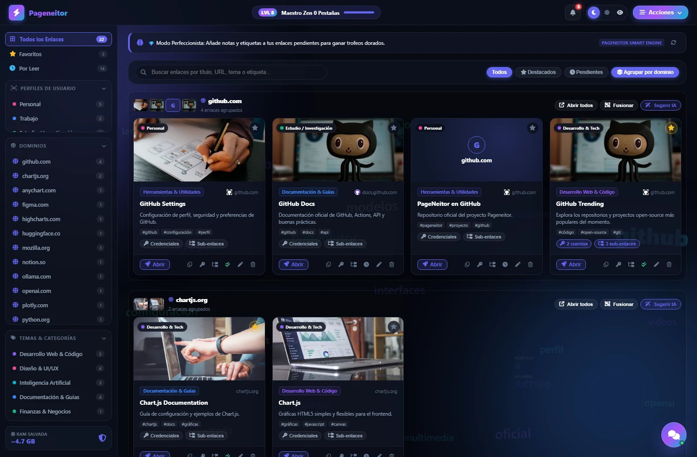
</p>

Pulsa **Agrupar por dominio** en la barra de filtros.

- Los enlaces de `github.com`, `docs.github.com` y `gist.github.com` se agrupan bajo `github.com`.
- Cada grupo muestra un **mosaico de miniaturas**.
- Cada enlace conserva su tarjeta y su miniatura individual.
- Desde el grupo puedes:
  - **Abrir todos** los enlaces.
  - **Fusionar** el grupo en un enlace principal.
  - **Sugerir IA** para que Ollama analice el grupo.

La agrupación de subdominios se puede activar o desactivar en **Panel de Control → Ollama**.

---

### 3. Detalle de un dominio

<p align="center">
  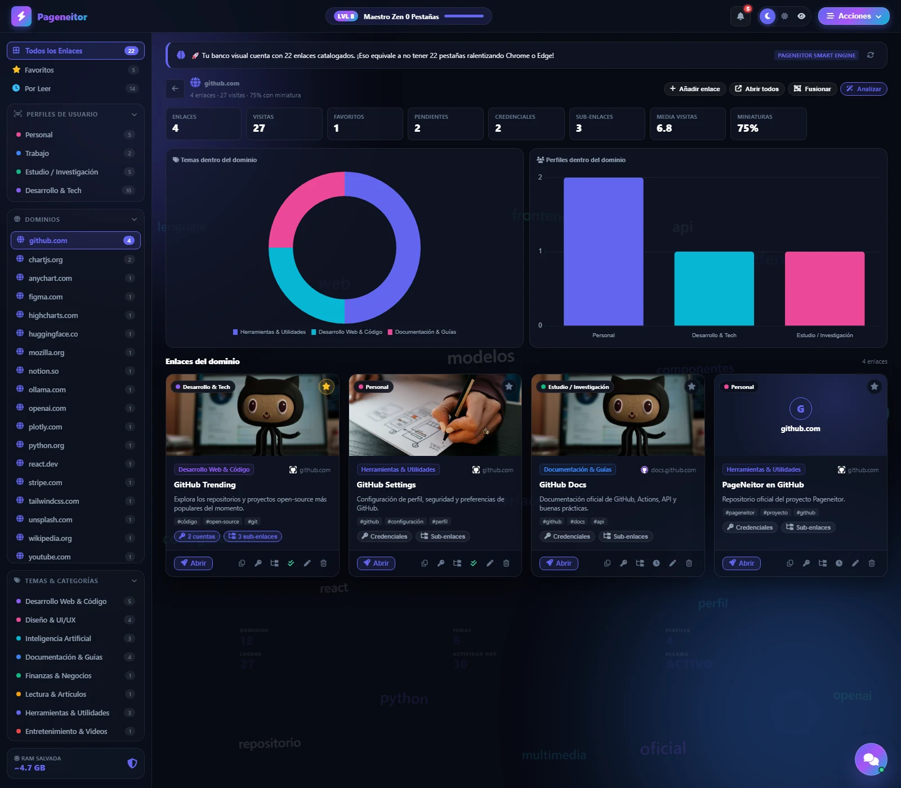
</p>

Pulsa un dominio en la barra lateral o en **Ver grupo**.

La vista de dominio incluye:

- Número de enlaces.
- Visitas totales.
- Favoritos y pendientes.
- Credenciales y subenlaces.
- Media de visitas.
- Cobertura de miniaturas.
- Gráfica de temas y perfiles dentro del dominio.
- Todos los enlaces con **miniatura, edición, eliminación, apertura y copia**.
- Botones para **añadir enlace**, **abrir todos**, **fusionar** o **analizar con Ollama**.

---

### 4. Asistente de enlaces

<p align="center">
  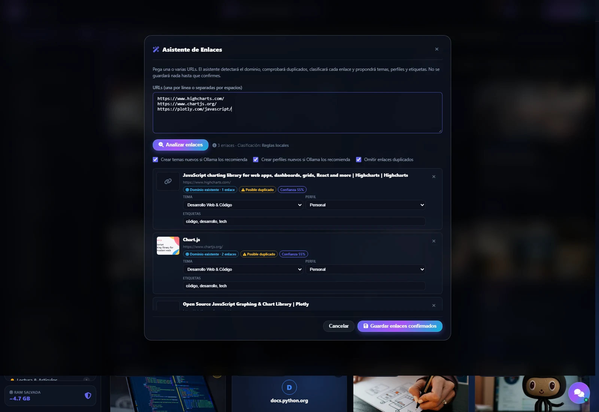
</p>

Abre **Acciones → Asistente de Enlaces** o pega URLs en el chatbot.

1. Pega una o varias URLs.
2. Pulsa **Analizar enlaces**.
3. El asistente extrae metadatos y comprueba si el dominio ya existe.
4. Ollama propone:
   - Tema.
   - Perfil.
   - Etiquetas.
   - Posibles duplicados.
   - Nuevos temas o perfiles si ninguno existente encaja.
5. Revisa y ajusta las propuestas.
6. Pulsa **Guardar enlaces confirmados**.

Nada se guarda ni se crea automáticamente. Los temas y perfiles nuevos se crean solo si los aceptas.

---

### 5. Chat asistente

<p align="center">
  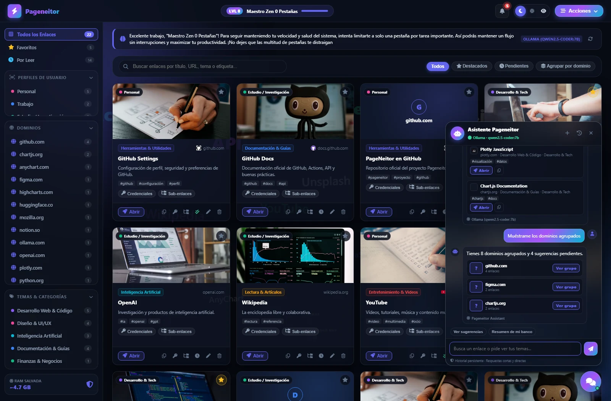
</p>

Pulsa el botón flotante de chat.

Puedes pedirle:

- `busca github`
- `enlaces de Inteligencia Artificial`
- `ver dominios`
- `ver perfiles`
- `enlaces sin leer`
- `resumen de mi banco`
- `fusiona github.com`
- `aplica la sugerencia 2`
- `deshaz la última acción`
- `abre figma`

El asistente usa **Ollama** para redactar respuestas cortas y un motor local determinista cuando Ollama no está disponible. Las conversaciones se guardan y se recuperan al volver a abrir la app.

---

### 6. Credenciales multiusuario

<p align="center">
  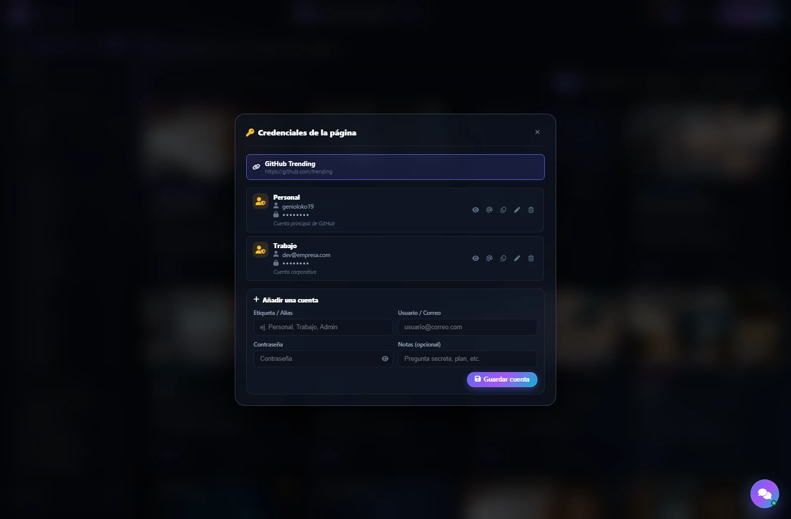
</p>

Cada enlace puede tener **varias cuentas**:

- Alias.
- Usuario o correo.
- Contraseña.
- Notas.

Puedes mostrar/ocultar la contraseña, copiar el usuario o la contraseña, editar y eliminar cada cuenta por separado.

> Las credenciales se guardan localmente en SQLite. Protege tu sesión de Windows y tus copias de seguridad.

---

### 7. Estadísticas y KPIs

<p align="center">
  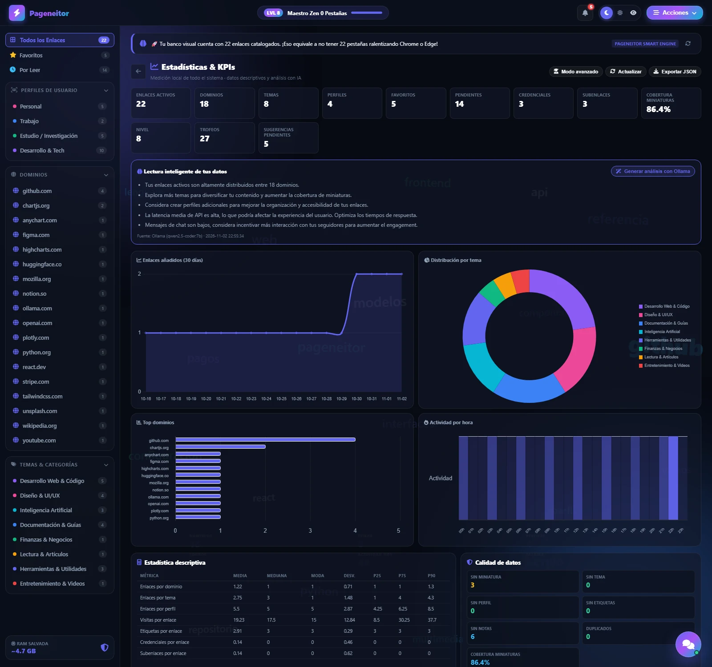
</p>

Abre **Acciones → Estadísticas & KPIs**.

Encontrarás:

- Enlaces activos, dominios, temas y perfiles.
- Favoritos, pendientes, credenciales y subenlaces.
- Cobertura de miniaturas.
- Nivel, trofeos y sugerencias pendientes.
- Enlaces añadidos en los últimos 30 días.
- Distribución por tema.
- Top dominios.
- Actividad por hora.
- Estadística descriptiva: media, mediana, moda, desviación y percentiles.
- Calidad de datos: enlaces sin miniatura, sin tema, sin perfil, sin etiquetas, sin notas y duplicados.
- Rendimiento de la API.
- Análisis con Ollama.

### 7.1. Modo avanzado

<p align="center">
  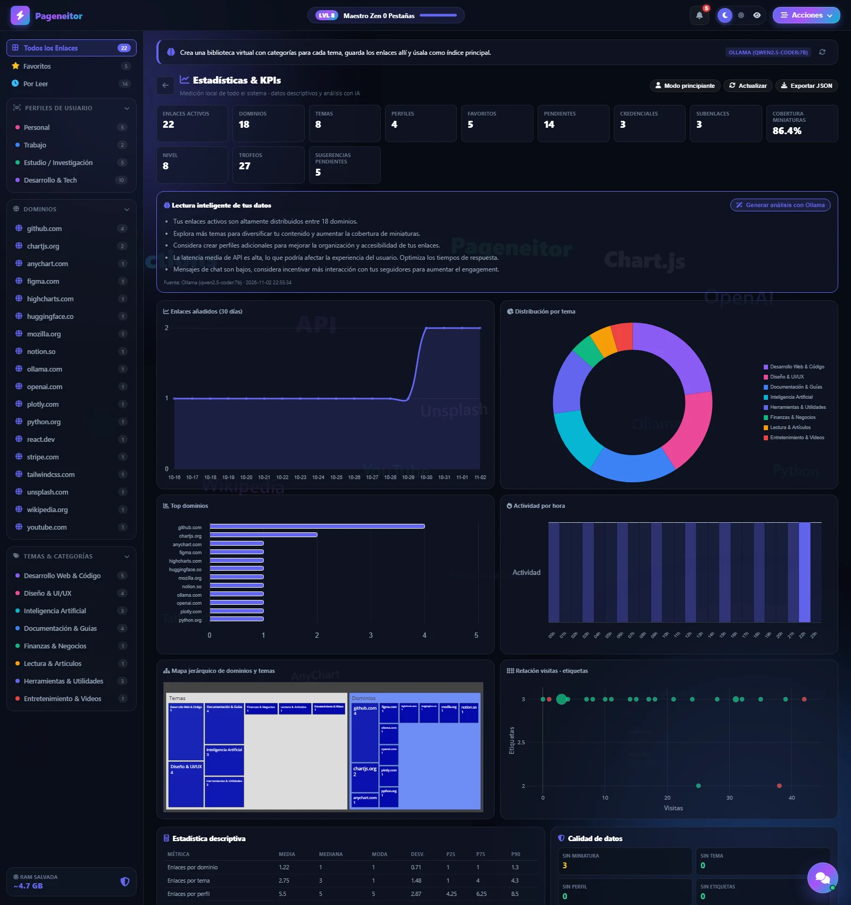
</p>

El modo avanzado añade:

- Treemap jerárquico de dominios y temas.
- Dispersión de visitas, etiquetas, credenciales y subenlaces.
- Tabla de eventos.
- Endpoints más usados.
- Latencias medias y P95.
- Exportación de métricas a JSON.

---

### 8. Copias de seguridad y base de datos

<p align="center">
  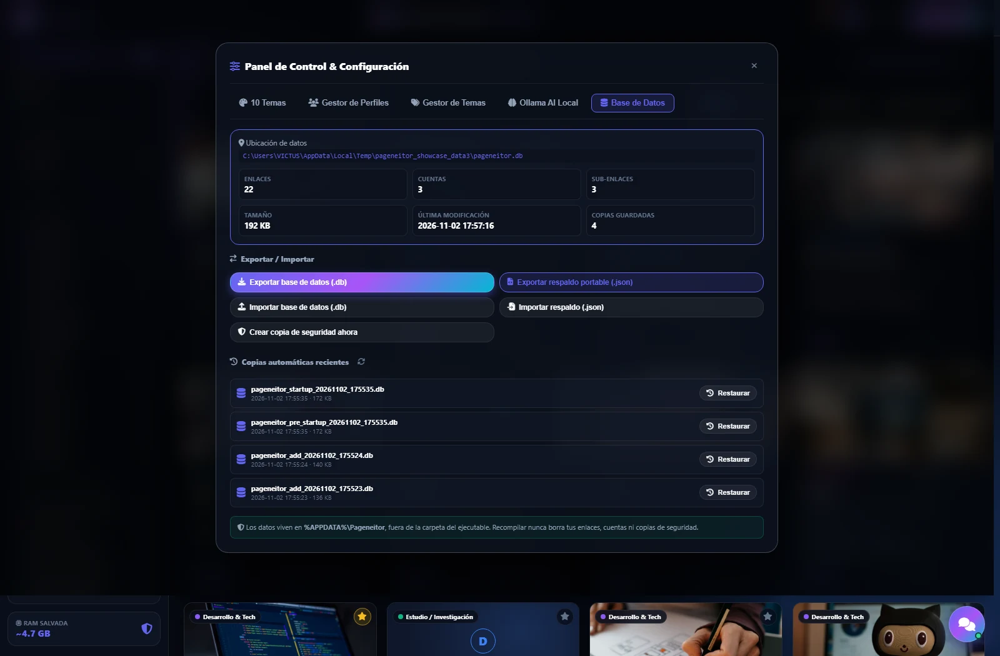
</p>

En **Panel de Control → Base de Datos**:

- Exportar base de datos `.db`.
- Exportar respaldo portable `.json`.
- Importar `.db`.
- Importar `.json` en modo fusionar o reemplazar.
- Crear copia manual.
- Restaurar copias automáticas.
- Ver la ubicación exacta de tus datos.

Cada operación delicada crea una copia de seguridad previa y puede deshacerse.

---

### 9. Temas y personalización

<p align="center">
  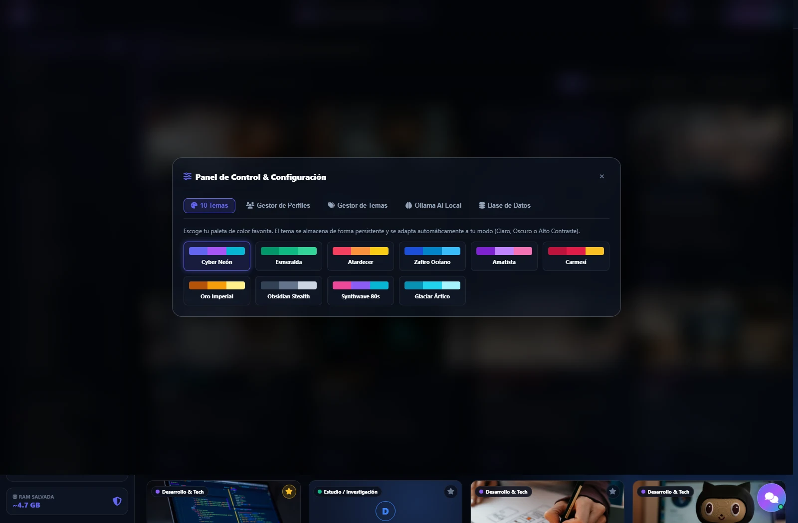
</p>

Elige entre **10 temas de color** y **3 modos**:

- Oscuro.
- Claro.
- Alto contraste.

La selección se guarda y se recupera al volver a abrir la aplicación.

---

### 10. Notificaciones y sugerencias

<p align="center">
  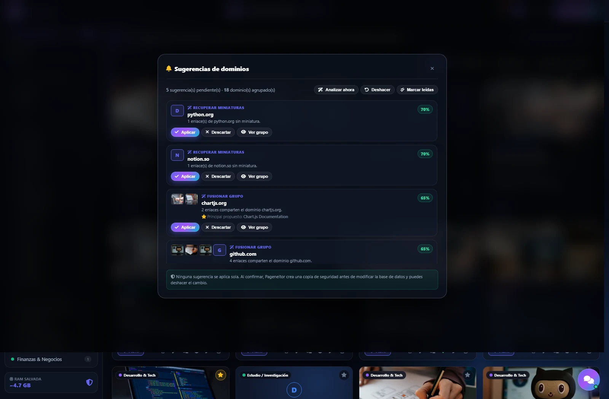
</p>

La campana reúne las sugerencias de Ollama:

- Fusionar enlaces del mismo dominio.
- Recuperar miniaturas que faltan.

Cada sugerencia muestra:

- Dominio afectado.
- Enlaces implicados con sus miniaturas.
- Enlace principal propuesto.
- Motivo generado por Ollama.
- Nivel de confianza.

Puedes **aplicar**, **descartar** o **ver el grupo**. Nada se aplica sin tu confirmación.

---

## 💡 Consejos de uso

- **Regla de cero pestañas:** si una pestaña lleva más de un día abierta sin usarse, guárdala y ciérrala.
- **Importa en bloque:** usa **Importar Pestañas** para vaciar el navegador de golpe.
- **Usa perfiles:** separa Personal, Trabajo, Estudio y Desarrollo.
- **Aprovecha los dominios:** agrupa y fusiona enlaces repetidos del mismo sitio.
- **Revisa la calidad:** las estadísticas te dicen qué enlaces no tienen miniatura, tema o perfil.
- **Pide ayuda al chat:** “busca python”, “ver dominios”, “resumen de mi banco”.
- **Haz copias:** exporta `.db` o `.json` antes de cambios grandes.

---

## 🔒 Privacidad

- La aplicación corre en `127.0.0.1`.
- Los datos viven en `%APPDATA%\Pageneitor`.
- Ollama se ejecuta localmente.
- No se envían credenciales a ningún modelo.
- La analítica es local y sin datos sensibles.
- Las librerías del frontend están empaquetadas; no depende de CDNs.

---

## 🗄️ Dónde están tus datos

```text
%APPDATA%\Pageneitor\
├── pageneitor.db
├── backups\
├── exports\
├── webengine\
└── pageneitor_crash.log
```

Puedes usar una ubicación portátil:

```bat
set PAGENEITOR_DATA_DIR=D:\MisDatos\Pageneitor
```

---

## 🧠 Ollama local

Pageneitor detecta Ollama en:

- `./ollama.exe`
- `%LOCALAPPDATA%\Programs\Ollama\ollama.exe`
- `PATH`

Si está instalado pero apagado, intenta iniciarlo. Si no está disponible, usa el motor local determinista.

```bash
ollama pull qwen2.5-coder:7b
ollama serve
```

El modelo se selecciona en **Panel de Control → Ollama**.

---

## 🏗️ Compilar el ejecutable

```bat
build.bat
```

Resultado:

```text
dist\Pageneitor\Pageneitor.exe
```

`build_windows.py`:

1. Cierra instancias abiertas.
2. Limpia artefactos antiguos y DLLs bloqueadas.
3. Compila en `.pyinstaller_build/`.
4. Verifica Python, QtWebEngine y recursos.
5. Solo entonces reemplaza `dist/Pageneitor/`.

Si falla, la versión anterior se conserva.

---

## 🧰 Stack técnico

- Python 3.10+
- Flask + Flask-Cors
- SQLite
- PySide6 / QtWebEngine
- PyInstaller
- HTML, CSS y JavaScript vanilla
- Chart.js, Highcharts y Plotly
- Ollama local

### Estructura

```text
PageNeitor/
├── app.py                  # Lanzador PySide6 + Flask
├── backend/
│   ├── server.py           # API REST
│   ├── database.py         # SQLite, migraciones y copias
│   ├── scraper.py          # Metadatos OpenGraph
│   ├── ollama_service.py   # Integración con Ollama
│   ├── chat_assistant.py   # Chat conversacional
│   ├── domain_service.py   # Dominios y sugerencias LLM
│   ├── link_assistant.py   # Inserción y clasificación
│   ├── analytics_service.py# KPIs, estadística y word cloud
│   └── domain_utils.py     # Normalización de dominios
├── frontend/
│   ├── index.html
│   ├── scripts/
│   ├── styles/
│   └── vendor/             # Librerías offline
├── docs/
│   ├── images/             # Capturas del README
│   ├── ARCHITECTURE.md
│   └── RELEASE_CHECKLIST.md
├── build_windows.py
├── requirements.txt
└── README.md
```

---

## 🔌 API local

El backend expone una API REST en `http://127.0.0.1:5241`.

| Área | Endpoints principales |
|---|---|
| Estado | `/api/status`, `/api/stats` |
| Enlaces | `/api/links`, `/api/links/<id>` |
| Credenciales | `/api/links/<id>/credentials` |
| Subenlaces | `/api/links/<id>/sublinks` |
| Asistente | `/api/chat`, `/api/chat/sessions` |
| Inserción | `/api/links/assistant/preview`, `/commit` |
| Dominios | `/api/domains/groups`, `/detail`, `/suggestions` |
| Analítica | `/api/analytics/overview`, `/insights` |
| Nube | `/api/wordcloud` |
| Respaldos | `/api/backup/export-db`, `/export-json`, `/import-db`, `/import-json` |

---

## 🧪 Verificación

```bash
python -m compileall app.py backend build_windows.py
node --check frontend/scripts/app.js
node --check frontend/scripts/api.js
```

---

## ❓ Solución de problemas

### La app no abre
- Comprueba que hayas descomprimido el ZIP completo.
- Ejecuta `Pageneitor.exe` desde la carpeta descomprimida.
- Revisa `%APPDATA%\Pageneitor\pageneitor_crash.log`.

### Ollama no responde
- Abre Ollama.
- Verifica con `ollama list`.
- Selecciona un modelo en **Panel de Control → Ollama**.

### No aparecen miniaturas
- Algunos sitios bloquean la extracción de OpenGraph.
- Puedes añadir una URL de miniatura manualmente al editar el enlace.

### Quiero mover mis datos
- Exporta `.json` o `.db` desde **Panel de Control → Base de Datos**.
- O copia `%APPDATA%\Pageneitor`.

---

## 🤝 Contribuir

Lee [CONTRIBUTING.md](CONTRIBUTING.md) y el [Código de Conducta](CODE_OF_CONDUCT.md).

## 🛡️ Seguridad

Consulta [SECURITY.md](SECURITY.md) para reportar vulnerabilidades de forma privada.

## 📄 Licencia

MIT. Consulta [LICENSE](LICENSE) y [THIRD_PARTY_NOTICES.md](THIRD_PARTY_NOTICES.md).

---

<p align="center">
  <strong>Pageneitor v3.9.1</strong><br>
  Hecho para mantener tu navegador y tu mente más ligeros.
</p>
